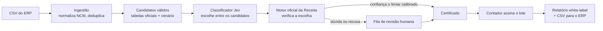

# Tributon

[](https://github.com/juliopessan/Tributon/actions/workflows/ci.yml?query=branch%3Amain)

**Cadastro errado vira nota rejeitada. Venda a correção com a sua marca.**

Desde 3 de agosto de 2026, cada item da NF-e do regime normal precisa de CST e cClassTrib corretos para o IBS e a CBS.
O Tributon revisa o cadastro de mercadorias inteiro, confere cada resposta no motor oficial da Receita Federal e entrega
pronto para o contador do escritório assinar. Para o escritório contábil, é uma linha nova de receita sem contratar ninguém;
para o cliente final, o trabalho sai com a marca do escritório.

> **Service-as-software.** Não vendemos uma ferramenta para o seu time operar: vendemos o resultado, cobrado **por SKU certificado**.
> Item pendente com o cliente ou fora do escopo não é cobrado.

---

## O problema não é a reforma. É o cadastro.

| | O que está em jogo | Fonte |
|---|---|---|
| **93%** | dos produtos com inconsistência: em 2,5 milhões de produtos de 4,5 mil empresas do regime normal, classificação IBS/CBS em branco, NCM descontinuado, GTIN inválido. | [IOB, jul/2026](https://www.contadores.cnt.br/noticias/artigos/2026/07/22/reforma-tributaria-mais-de-90-dos-produtos-cadastrados-por-empresas-apresentam-inconsistencias-para-adaptacao-ao-ibs-e-cbs.html) |
| **1024** | é a rejeição que trava o faturamento: CST e cClassTrib incompatíveis. A nota volta e a venda para. | [NT 2025.002 · Portal Contábeis, jun/2026](https://www.contabeis.com.br/noticias/77672/empresas-devem-revisar-ncm-e-cclasstrib-para-evitar-rejeicao-de-nf/) |
| **68%** | dos contadores já foram procurados pelos clientes sobre a Reforma; só 5% dos escritórios têm uma estratégia estruturada para responder. | [Sondagem Omie do Setor Contábil, 1º sem/2026](https://www.omie.com.br/assets/docs/report_sondagem_omie_contabil_1S2026.pdf) |

A rejeição automática dos campos vazios foi adiada; a obrigação de preencher, não. O cliente vai pagar alguém para arrumar o cadastro.
**Que seja o escritório dele.**

## Como funciona

1. **Envie o cadastro do cliente.** O CSV que o ERP já exporta, com `;` e acentos. Sem integração, sem trocar de sistema.
2. **Receba a fila só com as exceções.** Cada SKU sai com CST e cClassTrib escolhidos entre as opções válidas e conferidos no motor oficial. O time olha só o que ficou em dúvida.
3. **Assine e entregue com a sua marca.** O contador responsável assina o lote. O cliente recebe o relatório e o arquivo para o ERP com o nome e as cores do escritório.



## Por que confiar

| | Garantia | Como o código cumpre |
|---|---|---|
| **1 · Não chuta** | Só escolhe entre códigos válidos. | O modelo nunca inventa um cClassTrib: recebe só os candidatos que as tabelas oficiais aceitam para aquele NCM e aquele tipo de venda. |
| **2 · Confere** | Cada resposta passa no motor oficial. | A escolha roda na [Calculadora de Tributos de código aberto da Receita Federal](https://github.com/ReceitaFederal/calculadora-rtc-regime-regular) (tag `1.6.1`, MIT) antes de chegar ao time. Se o motor recusa, o modelo tenta a próxima opção válida e o item vai para revisão humana, nunca direto para certificado. |
| **3 · Você decide** | Humano em toda dúvida. | Até o escritório calibrar a confiança com 300 revisões, **tudo** passa pelo time. Depois, só as exceções. |

E ainda:
- **Garantia por resultado.** SKU certificado que der rejeição é creditado e reclassificado com prioridade.
- **White-label de verdade.** O relatório do cliente (`/r/<token>`) não mostra a marca Tributon, e o E2E verifica isso.
- **Dados mínimos.** Para o modelo de classificação vão só a descrição do produto e o NCM. Nunca CNPJ, preço ou volume.
- **Trilha de auditoria append-only.** Cada decisão (modelo, humano, assinatura, limiar) fica registrada e não pode ser apagada.
- **Isolamento por escritório.** Postgres com Row-Level Security: um escritório não enxerga os lotes de outro, nem por engano no código.

## Quanto rende

Escritórios já cobram em torno de R$ 500 por revisão de cadastro ([Portal Contábeis](https://www.contabeis.com.br/noticias/75957/reforma-tributaria-pode-gerar-ate-r-50-mil-em-nova-receita-para-contadores/)).
O escritório define o preço para o cliente; o Tributon cobra só por SKU certificado. A landing traz um simulador de margem.

---

## Instalação passo a passo

Ambiente de desenvolvimento completo: motor oficial, Postgres, worker e web. Leva uns 15 minutos na primeira vez, quase todos compilando o motor.

### 0. Pré-requisitos

| Ferramenta | Versão | Para quê |
|---|---|---|
| Node.js | 22.18 ou mais nova | web, worker e pacotes (TypeScript roda direto com `--experimental-strip-types`) |
| pnpm | 10.28 (o `packageManager` do `package.json`) | monorepo. Com Corepack: `corepack enable` |
| Java | 21 | compilar e rodar o motor oficial |
| PostgreSQL | 16 | banco multi-tenant com RLS |
| git, curl, openssl | qualquer recente | clonar o motor, checar saúde, gerar segredo |

### 1. Clone e instale as dependências

```bash
git clone https://github.com/juliopessan/Tributon.git
```

```bash
cd Tributon
```

```bash
pnpm install --frozen-lockfile
```

### 2. Suba o motor oficial (terminal 1)

O script clona o repositório da Receita Federal na tag fixada, gera o banco SQLite das tabelas (Flyway), compila e sobe o serviço em `:8080`.
Na primeira vez demora (Maven baixa as dependências); nas seguintes, sobe em segundos.

```bash
engine/run-engine.sh
```

Quando aparecer `[engine] pronto`, confira em outro terminal:

```bash
curl -s http://localhost:8080/api/calculadora/dados-abertos/versao
```

A resposta traz `"versaoApp":"1.6.1"`. Variáveis opcionais: `ENGINE_REF` (outra tag), `ENGINE_PORT`, `ENGINE_MGMT_PORT`, `ENGINE_SRC`.
Prefere Docker? `docker build -t tributon-engine:1.6.1 engine/`.

### 3. Prepare o Postgres (terminal 2)

**Opção A: Postgres descartável do projeto** (porta `55432`, dados em `/tmp/tributon-pg`, sem senha):

```bash
eval "$(scripts/test-db.sh)"
```

```bash
psql -h localhost -p 55432 -U postgres -c "CREATE DATABASE tributon"
```

**Opção B: o seu Postgres 16.** Crie o banco `tributon` e ajuste as três URLs no passo 4. A migração precisa de um usuário com permissão para criar papéis (ela cria `tributon_app` e `tributon_worker`).

### 4. Configure o ambiente

```bash
cp .env.example .env
```

Edite o `.env`:

| Variável | O que colocar |
|---|---|
| `SESSION_SECRET` | um segredo com 32+ caracteres. Gere com `openssl rand -base64 48` |
| `CLASSIFIER_BACKEND` | `jev` (padrão, classificador real) ou `fake` (demonstração sem rede e sem chave) |
| `TYPESAFE_API_KEY` | sua chave da TypeSafe (System One / Jev), se usar `jev` |
| `NODE_USE_ENV_PROXY` | `1` só se a máquina sai para a internet por proxy HTTP(S); senão, apague a linha |
| `DATABASE_URL*` | já apontam para a opção A; troque se usar o seu Postgres |
| `ENGINE_URL`, `VERIFY_MUNICIPIO`, `VERIFY_UF` | já apontam para o motor local e para o município usado na verificação |

> **Importante:** nenhum processo lê o `.env` sozinho. Carregue-o **em cada terminal** antes de rodar a migração, o worker ou a web:
>
> ```bash
> set -a; . ./.env; set +a
> ```

### 5. Crie as tabelas

```bash
pnpm --filter @tributon/db migrate
```

Saída esperada: `aplicadas: 001_init.sql, …, 007_reivindicacao.sql`. Rodar de novo é seguro (`nada a aplicar`).

### 6. Suba o worker (terminal 3, com o `.env` carregado)

```bash
pnpm --filter @tributon/worker start
```

Saída esperada: `[worker] backend=jev engine=http://localhost:8080/api/calculadora`. Ele busca lotes na fila a cada 5 s (`WORKER_POLL_MS`).

### 7. Suba a web (terminal 4, com o `.env` carregado)

```bash
pnpm --filter @tributon/web dev
```

Abra **http://localhost:3000**. Para rodar como em produção:

```bash
pnpm --filter @tributon/web build
```

```bash
pnpm --filter @tributon/web start
```

### 8. Primeiro uso, do upload à assinatura

1. Em **/cadastro**, crie o escritório e o usuário sócio.
2. Em **Equipe**, cadastre um usuário com o papel *contador responsável* (só ele assina lotes) e, se quiser, analistas.
3. Em **Marca**, defina nome, cor e logo: é o que o cliente final vai ver.
4. Em **Lotes**, envie um CSV. Para testar, use `e2e/fixtures/cadastro-latin1.csv` (Latin-1, separado por `;`). O lote entra na fila e o worker processa em segundos.
5. Na **fila de revisão**, aprove, troque (apenas entre candidatos válidos) ou devolva cada exceção.
6. Entre como contador responsável e **assine o lote**. Isso gera o link do relatório white-label `/r/<token>` e libera a exportação CSV para o ERP.
7. Depois de 300 revisões, **Calibração** sugere um limiar de confiança; a partir daí só as exceções vão para a fila.

### Servidor MCP (opcional)

Expõe `buscar_candidatos`, `classificar`, `verificar_no_motor` e `explicar_erro_reg` para um agente Claude, com o `.env` carregado:

```bash
pnpm --filter @tributon/mcp start
```

### Problemas comuns

| Sintoma | Causa e solução |
|---|---|
| `DATABASE_URL_APP não definida` (ou outra variável) | O `.env` não foi carregado neste terminal: `set -a; . ./.env; set +a`. |
| Lote fica parado em *Na fila* | O worker não está rodando, ou não alcança o motor (`ENGINE_URL`). Veja o log do worker. |
| SKUs em *erro temporário* | O motor caiu ou o Jev não respondeu. Com tudo de pé, clique em **Reprocessar** no lote: só os itens pendentes rodam de novo. |
| `fetch failed` ao chamar o Jev atrás de proxy | Defina `NODE_USE_ENV_PROXY=1`. |
| Porta 3000 ou 8080 ocupada | Use `next dev -p <outra>` em `apps/web`, ou `ENGINE_PORT=<outra>` e ajuste `ENGINE_URL`. |

---

## Testes e CI

Unidade e integração (Postgres descartável; os testes do motor e do Jev são pulados sem `ENGINE_URL` / `JEV_LIVE`):

```bash
eval "$(scripts/test-db.sh)" && pnpm -r --workspace-concurrency=1 test
```

Incluindo os testes contra o motor oficial (com o motor rodando):

```bash
eval "$(scripts/test-db.sh)" && ENGINE_URL=http://localhost:8080/api/calculadora pnpm -r --workspace-concurrency=1 test
```

Para incluir também o Jev ao vivo, acrescente `JEV_LIVE=1` (e `NODE_USE_ENV_PROXY=1` atrás de proxy).

Checagem de tipos de todos os pacotes:

```bash
pnpm typecheck
```

E2E completo (Postgres, motor, worker, web em build de produção e Chromium via Playwright, com o motor rodando):

```bash
e2e/run-e2e.sh
```

O [CI](.github/workflows/ci.yml) roda tudo isso em cada pull request, em dois jobs: **Typecheck e testes** e **Motor oficial e E2E**
(sobe o motor na tag `1.6.1`, roda os testes do motor e o E2E, e guarda logs e capturas como artefato).

## Estrutura do monorepo

| Caminho | Papel |
|---|---|
| `packages/classifier` | Núcleo genérico e reutilizável: `classify()`, `JevBackend` (TypeSafe System One), `FakeBackend`, `calibrate()` |
| `packages/tax-pack` | Domínio fiscal: `EngineClient`, `CandidateIndex` (cenário `cenarios/venda-interna-v1.json`), `verificar()` |
| `packages/pipeline` | A skill líder em código: `ingerirCsv()`, `executarSku()`, `rotear()` |
| `packages/db` | Postgres multi-tenant com RLS, auditoria append-only, migrações `001`–`007` |
| `packages/mcp` | Servidor MCP com as ferramentas do pipeline |
| `apps/worker` | Processa lotes: retomável, com concessão (lease) e versão do motor fixada por lote |
| `apps/web` | Next.js no design system Ledger: landing, cadastro/login, painel, fila de revisão, calibração, cenário, equipe, marca, relatório `/r/<token>`, exportação CSV |
| `skills/` | `lider-auditoria` e especialistas (`ingestao`, `candidatos`, `classificador`, `verificador`, `dossie`, `exportacao`) |
| `engine/` | Script e Dockerfile do motor oficial (clonado na tag fixada) e `NOTICE` |
| `e2e/` | Fluxo completo no navegador e o CSV de exemplo |
| `docs/` | Design (v1 e v1.1), planos e perguntas para a validação jurídica |

## Regras do produto (não negociáveis)

- Nenhum valor tributário vem do modelo: o modelo só escolhe entre candidatos, e o motor verifica.
- Sem limiar calibrado (`lotes.threshold` nulo), **tudo** vai para revisão humana.
- Para o Jev vão só `{descricao, ncm}`.
- O relatório do cliente mostra só a marca do escritório.
- Só o contador responsável assina um lote.

## Antes de ir para produção

- **Cenário v1 provisório.** A lista `packages/tax-pack/cenarios/venda-interna-v1.json` precisa ser revisada e assinada por um contador (a tela **Cenário** existe para isso).
- **Senhas dos papéis do banco.** A migração cria `tributon_app` e `tributon_worker` com senhas de desenvolvimento. Troque com `ALTER ROLE … PASSWORD` e atualize as URLs.
- **Validação jurídica** do contrato e da garantia: roteiro em `docs/juridico/perguntas-para-advogado.md`.
- **Limites conhecidos:** não há limite de tentativas de login; o tamanho do upload é checado depois da leitura do arquivo.

## Créditos

O motor de cálculo é a [Calculadora de Tributos – regime regular](https://github.com/ReceitaFederal/calculadora-rtc-regime-regular),
© Receita Federal do Brasil, licença MIT (veja `engine/NOTICE`). O Tributon usa o motor como verificador; isso não implica endosso da Receita Federal.
O classificador é o Jev, da [TypeSafe](https://typesafe.ai/blog/introducing-system-one-models-and-jev).
